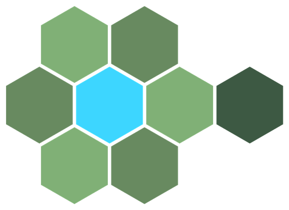
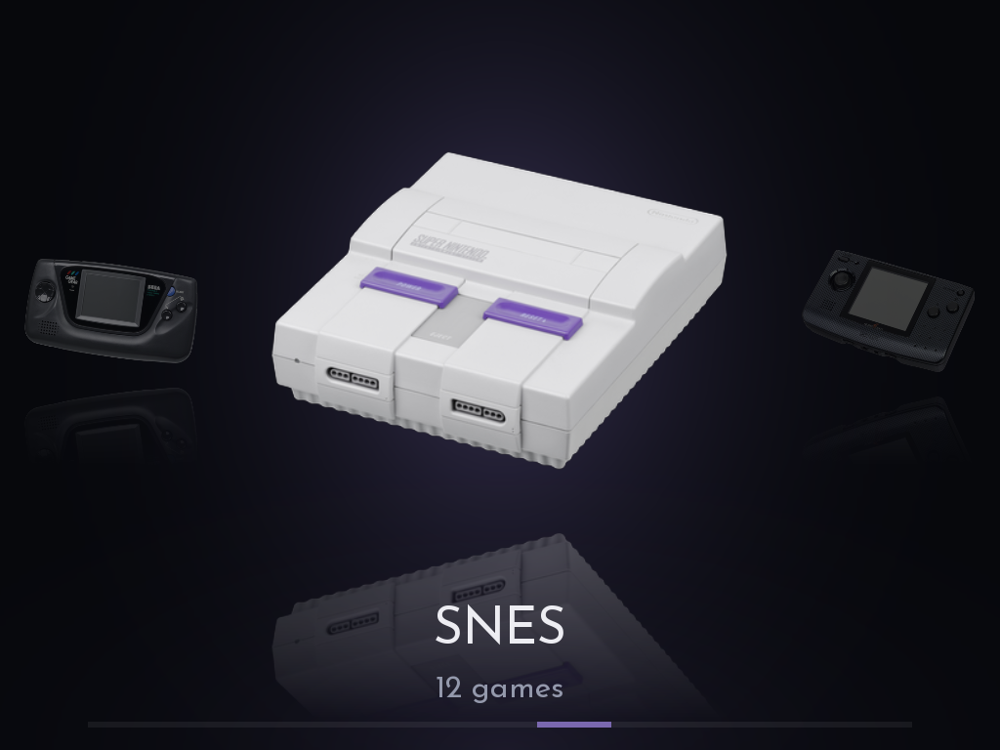
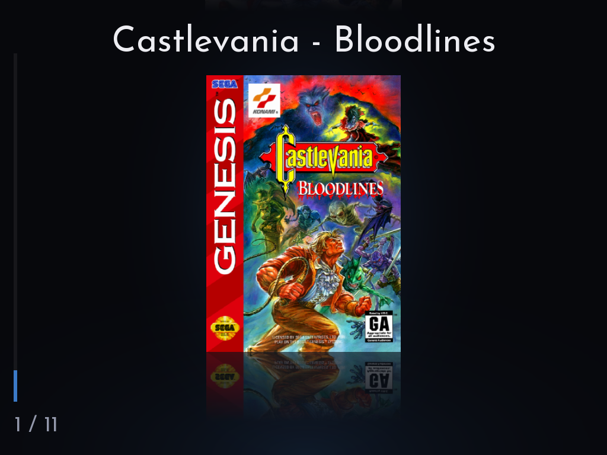
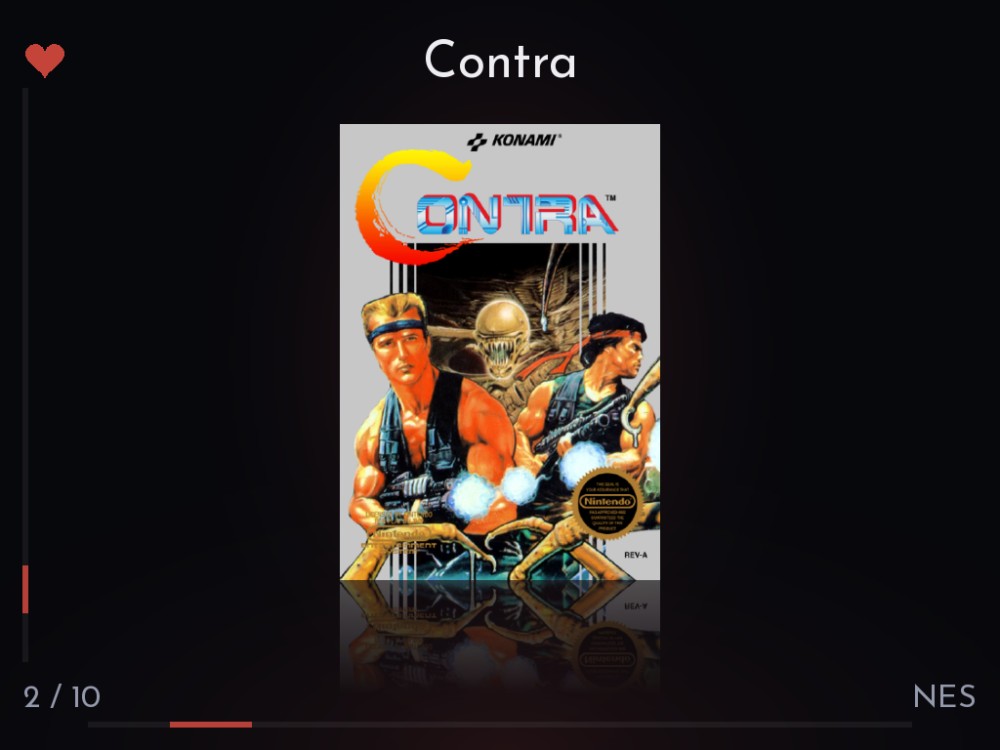
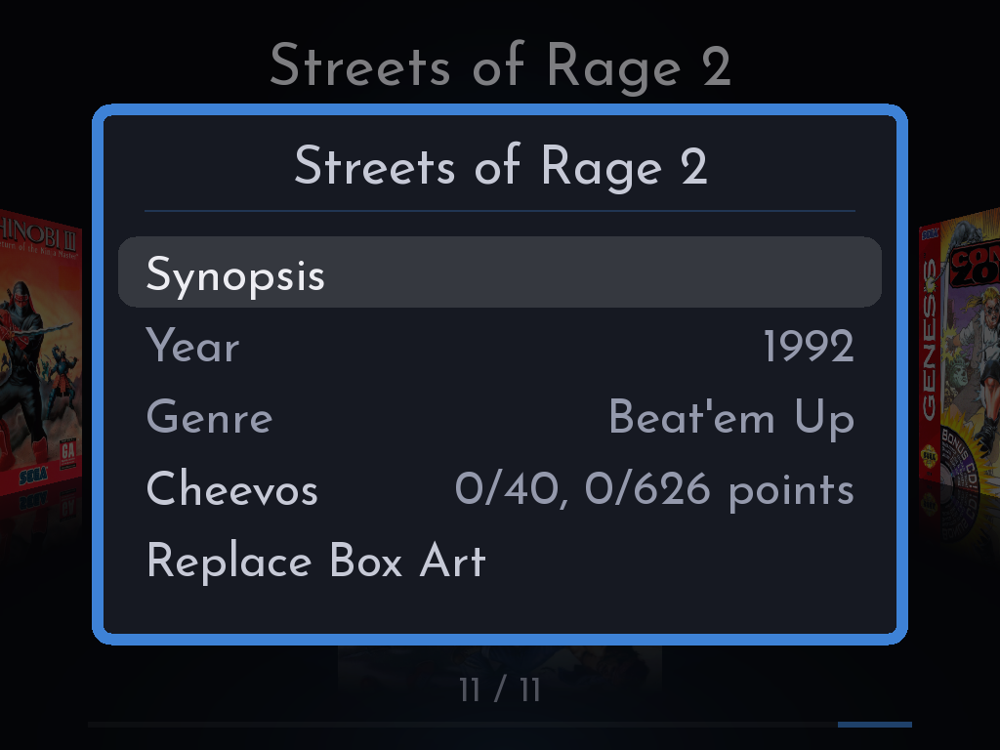
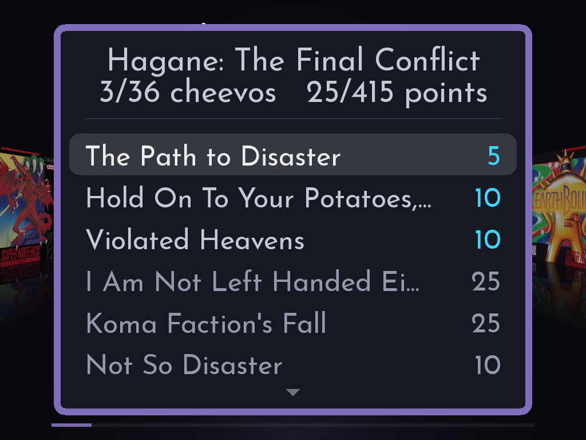
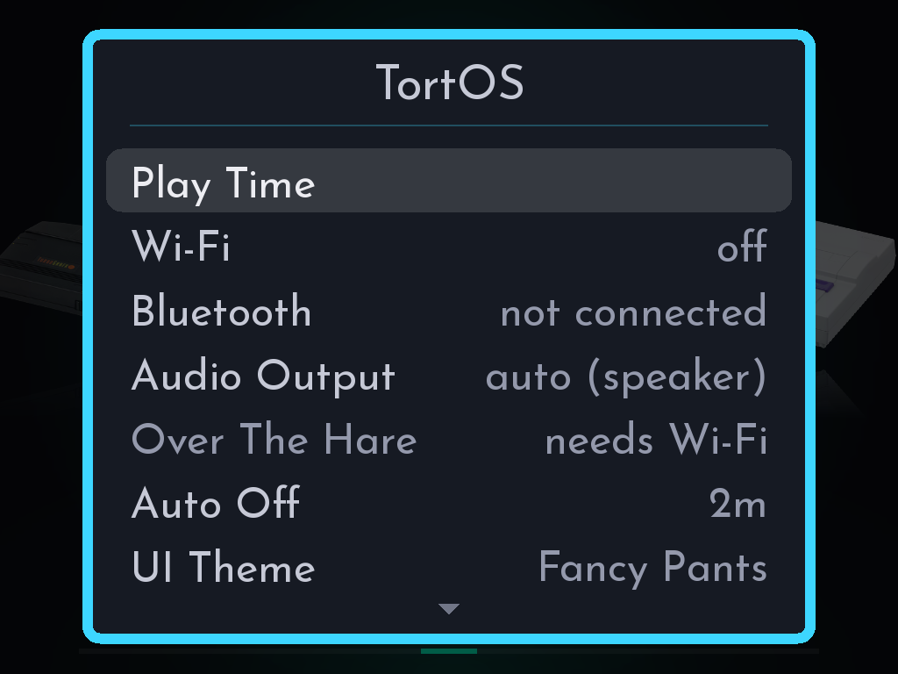
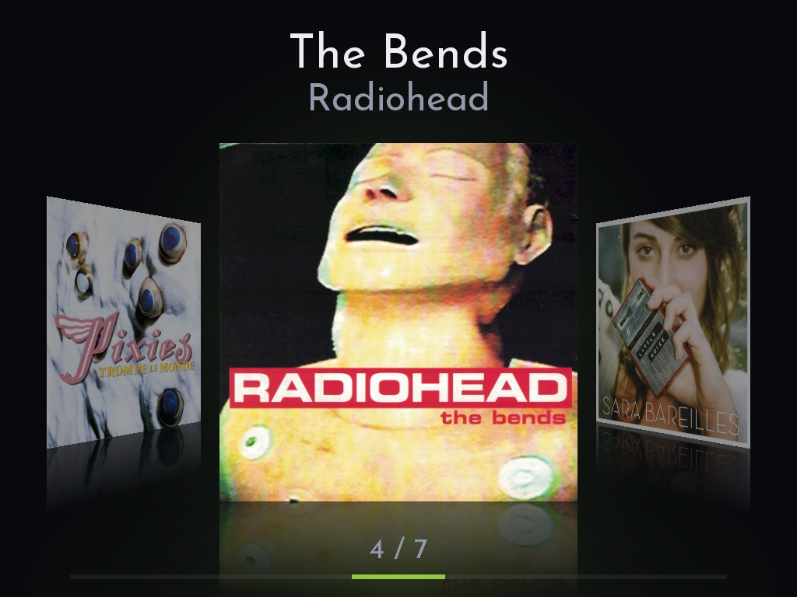
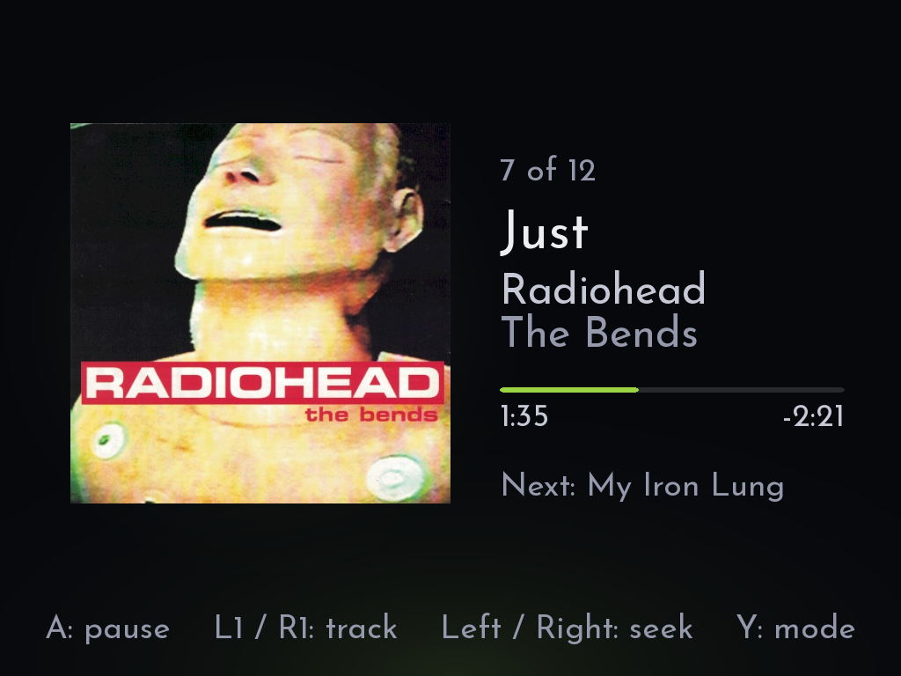
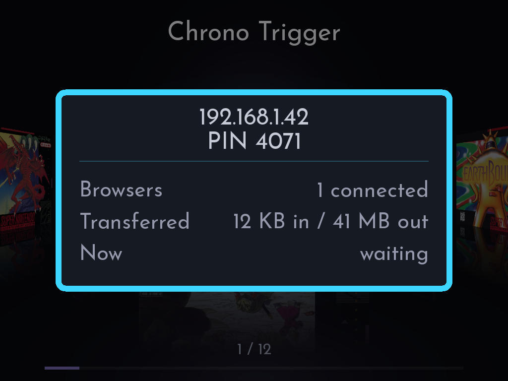

  
  &nbsp;&nbsp;&nbsp;&nbsp;
  

  <b>A <ins>fast</ins>, focused custom firmware for the TrimUI Brick, Brick Hammer and GKD Pixel 2.</b> 
  Plays eleven classic consoles and your music, and gets out of your way.

  <a href="#install">Install</a> &nbsp;·&nbsp;
  <a href="#supported-systems">Systems</a> &nbsp;·&nbsp;
  <a href="#controls">Controls</a> &nbsp;·&nbsp;
  <a href="#faq">FAQ</a>

  
https://github.com/user-attachments/assets/09b52bf2-bdb6-4a93-8613-27059d825ebf

<table>
  <tr>
    <td align="center" colspan="2"> Scroll horizontally</td>
    <td align="center" colspan="2"> Vertically</td>
    <td align="center" colspan="2"> Or as a cube</td>
  </tr>
  <tr>
    <td align="center" colspan="2"> A game's details, one button away</td>
    <td align="center" colspan="2"> RetroAchievements on the device</td>
    <td align="center" colspan="2"> The Brick's settings in one menu</td>
  </tr>
  <tr>
    <td align="center" colspan="3"> Your albums, in Muse</td>
    <td align="center" colspan="3"> Now Playing, on SELECT from anywhere</td>
  </tr>
</table>

## Why TortOS

**Games start the moment you press A.** The emulator is already running before you choose anything, so nothing loads between you and the game, even when you switch consoles.

**You pick up exactly where you left off.** Quit from the menu or just press the power button. The game is saved on the way out, and next time it continues from that moment.

**Everything happens on the handheld.** Join Wi-Fi, fetch box art, sign in to RetroAchievements, pair headphones and send games over from your phone, all on the Brick. You need a computer once, to set up the card.

**Your Brick stays yours.** TortOS runs from the SD card and changes nothing on the Brick itself. Take the card out and the Brick boots its own system again.

## Features

- **Three ways to browse:** a row of covers, a column, or a cube that turns both ways.
- **Two looks:** Plain Jane cards, or Fancy Pants photos of each console.
- **RetroAchievements:** sign in on the device. A game's achievements download once and then work offline, and anything you unlock offline is sent later.
- **Box art the Brick finds itself,** from libretro's collection with no account, or from ScreenScraper with a free one, which brings each game's year, genre and synopsis too. Or add your own.
- **Over The Hare:** move games, music, audiobooks, saves and covers on and off the card from any browser on your Wi-Fi, behind a PIN. Or over a USB cable from your computer, with no Wi-Fi at all, as Down To The Wire.
- **Autosave and resume,** plus six save slots for when you want a checkpoint.
- **Turbo buttons:** X and Y press A and B for you, on the nine consoles whose controllers had two face buttons. On Game Boy Advance, L2 and R2 do the same for L and R.
- **Fast forward:** hold MENU and press R1 to run a game at 2x, 3x or 4x, and once more to go back.
- **A USB-C headphone adapter on the Pixel 2:** plug one in and the sound goes there, ahead of the headphone jack, in games and in Muse. It's a choice of its own in Audio Output.
- **Bluetooth headphones,** paired on the device, with the Brick's volume buttons reaching them and their own buttons playing and skipping in Muse. Plug in wired ones and they take over.
- **Mono audio,** for anyone who hears with one ear: Audio Channels plays games and Muse in mono, or in mono in just the left or right ear on headphones.
- **Muse, a music and audiobook player:** your albums and books on a shelf of their own covers, and every book picks up where you left it. SELECT opens Muse from anywhere, even the in-game menu, and it keeps playing when you close it. While it plays, the game is silent.
- **Play Time:** how long you've played each game or console, today, this week, this month, this year or ever.
- **Favorites and sorting:** Y favorites a game, and each console sorts by name, play time, last played or recently added.

## Supported systems

| Console | Put games in | File types | Core |
|---|---|---|---|
| NES | `Roms/NES` | `.nes` `.fds` `.unf` `.unif` `.zip` | FCEUmm |
| Master System | `Roms/Master System` | `.sms` `.zip` | Genesis Plus GX |
| Game Boy | `Roms/Game Boy` | `.gb` `.dmg` `.zip` | mGBA |
| Genesis | `Roms/Genesis` | `.md` `.gen` `.bin` `.smd` `.zip` | Genesis Plus GX |
| TurboGrafx-16 and CD | `Roms/TurboGrafx-16` | `.pce` `.sgx` `.cue` `.ccd` `.chd` `.toc` `.m3u` `.zip` | Beetle PCE Fast |
| Game Gear | `Roms/Game Gear` | `.gg` `.zip` | Genesis Plus GX |
| SNES | `Roms/SNES` | `.sfc` `.smc` `.zip` | Snes9x 2010 |
| Neo Geo Pocket | `Roms/Neo Geo Pocket` | `.ngp` `.ngc` `.ngpc` `.npc` `.zip` | Beetle NeoPop |
| Game Boy Color | `Roms/Game Boy Color` | `.gbc` `.cgb` `.zip` | mGBA |
| Neo Geo Pocket Color | `Roms/Neo Geo Pocket Color` | `.ngp` `.ngc` `.ngpc` `.npc` `.zip` | Beetle NeoPop |
| Game Boy Advance | `Roms/Game Boy Advance` | `.gba` `.agb` `.zip` | mGBA |

**BIOS files** go loose in `Bios/`. Only TurboGrafx-CD games need one, `syscard3.pce`. Game Boy Advance runs without its BIOS; add `gba_bios.bin` if you want the original boot animation.

## Install

You need a TrimUI Brick, Brick Hammer or GKD Pixel 2, a microSD card and, just this once, a computer.

The [TortOS Installer](https://github.com/ericreinsmidt/TortOS-Installer/releases/latest), for macOS, Windows and Linux, sets up a card for either device: it downloads the latest TortOS and puts it on the card, or updates a card that already has it. The steps below also say how to do it by hand.

### Setting up a card

The card is the whole system on both devices: TortOS on [plastron](https://github.com/ericreinsmidt/plastron), a small Linux built for them.

With the TortOS Installer, choose your device and **Fresh install**, then go on from step 3. By hand, from the start:

1. **Download your device's image** from [Releases](https://github.com/ericreinsmidt/TortOS/releases/latest): `TortOS-v2.0.0-brick.img.xz` for the Brick and Brick Hammer, `TortOS-v2.0.0-pixel2.img.xz` for the Pixel 2.
2. **Write it to the card** with any program that writes disk images, like Raspberry Pi Imager. It erases everything on the card.
3. **Put the card in the device and turn it on.** The first boot takes a bit longer while it turns the rest of the card into space for games, music and saves. Every boot after that comes straight up.
4. **Set the time zone** under **MENU > Date & Time**. Wi-Fi sets the time whenever it connects; without it, set the time there too, and it keeps it.
5. **Add games** to the folders in `Roms/`. Put the card back in the computer, where it shows up as TORTOS, or send them over later, with Wi-Fi or the USB cable.

> [!NOTE]
> **Coming from TortOS 1.x on the Brick?** First copy your games, music and audiobooks off the card yourself: the installer erases them with the card and doesn't keep them. Then put the card in the computer and choose **TrimUI Brick** and **Fresh install** in the TortOS Installer. It copies your saves, settings and BIOS files to a folder in your Documents and erases the card. After the Brick's first start, put the card back in the computer and choose **Put them back** to restore those saves, settings and BIOS files. Then copy your games, music and audiobooks back onto the card.

The Pixel 2 has no radio of its own. A USB Wi-Fi adapter in its USB-C port gives it Wi-Fi while it's plugged in, and with it box art, RetroAchievements and Over The Hare: one whose Realtek chip the Linux rtl8xxxu driver knows, like the TP-Link TL-WN725N on a USB-C adapter. Without one, Down To The Wire (below) moves files over the USB cable and fetches box art and album covers through your computer. Or add your own. There's no Bluetooth.

### Updating

Put the card in the computer and choose **Update** in the TortOS Installer. The new TortOS goes on, and the games, music, saves and settings stay. The first boot after takes a bit longer while it copies the new TortOS into place.

The installer is the only way that keeps them: writing the image by hand erases the card.

### Adding games over Wi-Fi

1. Join a network under **MENU > Wi-Fi**.
2. Open **MENU > Over The Hare**. It shows an address and a PIN.
3. Open that address in a browser on your phone or computer, and type the PIN.
4. Drag games into their console's folder, albums into `Music` or books into `Audiobooks`. They're on the shelf when you leave the screen.

The PIN is new every time you open Over The Hare.

 

### Adding games over the USB cable

The same thing over a cable, with no Wi-Fi, called Down To The Wire. It works with a Mac, Linux, or Windows 11; Windows 10 has no driver for this kind of connection.

1. Plug the device into the computer with a USB cable.
2. Open **MENU > Down To The Wire**, which takes Over The Hare's place while a computer is on the cable. It shows an address and a PIN.
3. Open that address in a browser on that computer, `http://10.55.0.2` on the Brick or `http://10.42.0.1` on the Pixel 2, and type the PIN.
4. Drag games into their console's folder, albums into `Music` or books into `Audiobooks`. They're on the shelf when you leave the screen.

### Removing TortOS

Take the card out. The Brick boots its own system again, as it was. On the Pixel 2 the card is the system, so another card with another system replaces it.

Everything TortOS keeps is on the card, Wi-Fi passwords and Bluetooth pairings included, so reformat it before you give it away.

## Controls

| Button | What it does |
|---|---|
| **A / B** | Choose and back |
| **MENU** | Settings for whatever you're looking at. In a game: save, load, quit and more |
| **SELECT** | Muse, the music and audiobook player, from anywhere |
| **MENU + R1** | Fast forward a game |
| **X / Y** | In a game, turbo A and B. On the shelf, a game's details and favorite |
| **POWER** | Save and turn off |

The device lists every button under **MENU > Controls**, and [the guide](docs/guide.md#controls-and-menus) covers every control, menu and setting in detail.

## FAQ

<b>My games don't show up.</b>

Check the folder name against the table above, spelled exactly, and that the file type is listed for that console. A console with nothing in its folder is hidden. Games sent over Over The Hare appear when you leave its screen. Games copied any other way while the Brick is on appear after **Rescan Folder** in that console's menu, or after a restart. The log names every file a console's folder left out, and the file types it takes.

<b>A game has no box art.</b>

**MENU > Box Art** fetches every missing cover over Wi-Fi. Sign in to a free [ScreenScraper](https://www.screenscraper.fr) account under **MENU > ScreenScraper** and it asks there first, and brings each game's year, genre and synopsis for its details screen. Without an account, or for a game ScreenScraper doesn't have, it uses [libretro's thumbnail collection](https://thumbnails.libretro.com), looking a game up by its file name and, for zipped games, by checksum.

Some games aren't in either collection, like fan translations and homebrew. Add your own: a PNG named exactly like the game file, in `Roms/<console>/.media/`. `Black Castle.gb` wants `Black Castle.png`. Around 512 pixels on the long side is plenty.

Don't like a cover? Press X on the game and choose **Replace Box Art**. It looks again, and if nothing turns up, you keep the one you had.

<b>How do achievements work?</b>

Sign in to your RetroAchievements account under **MENU > Cheevos**. The first time you start a game, the device needs Wi-Fi to look it up and download its achievements. After that the game works offline, and anything you unlock offline is kept and sent to your account later.

<b>Can I use Bluetooth headphones?</b>

Yes, on the Brick. Put them in pairing mode, open **MENU > Bluetooth**, press **Y** to search and **A** to pair. They reconnect by themselves from then on. Wired headphones always win when they're plugged in.

The Brick's volume buttons set the headphones' volume, and the headphones' own volume buttons move the Brick's. On a few headphones, the Brick's buttons set only the starting volume; after that, change it on the headphones themselves. Play, pause and skip on the headphones control Muse.

The Pixel 2 has no Bluetooth: use wired headphones, or a USB-C headphone adapter.

<b>How do I add music?</b>

Put it in `Music/` on the card, from a computer, over Wi-Fi with Over The Hare, or over the USB cable with Down To The Wire, a folder per artist and a folder inside that per album: `Music/Radiohead/The Bends/01 Planet Telex.mp3`. An album folder put straight into `Music/` is moved under its artist when its tags name one, and songs in no folder at all are moved into `Music/Singles/`, an album of their own. MP3, M4A, M4B, MP4, AAC, FLAC, Ogg, Opus and WAV all play. Muse appears on the shelf once there's music, and each album's cover comes from its own files, or a picture in the album's folder. **MENU > Album Art** on Muse's shelf fetches a sharper cover over Wi-Fi from [MusicBrainz](https://musicbrainz.org)'s Cover Art Archive for any album whose files carry none, or only a small one.

<b>How do I add audiobooks?</b>

Put each book in its own folder in `Audiobooks/`, with an author's folder above it or without: `Audiobooks/Iain M. Banks/The Hydrogen Sonata/` or `Audiobooks/The Hydrogen Sonata/`. One M4B or a folder of MP3s both work, and the files play in name order. **MENU > Show** on Muse's shelf switches between your music and your books. A book remembers where you stopped, even through a power-off, and one played to the end is marked finished; A on it starts it over.

<b>Where are my saves?</b>

Battery saves are `.srm` files in `Saves/`, named after the game. Save states, the autosave included, are in `.userdata/shared/.tortos/`, one folder per console. Neo Geo Pocket Color games write no `.srm`, so their progress lives in the autosave.

<b>Something went wrong. How do I send the logs?</b>

Open **MENU > Over The Hare** (**Down To The Wire** over the USB cable), open its address in a browser, and click **Download logs** at the bottom of the first page. You get one `.tar.gz` file holding the last ten boots' logs and a short summary of the device, ready to send to whoever is helping you. Wi-Fi network, headset and account names are masked in it, and the logs on the card are left as they are. The logs themselves are on the card, in `.userdata/brick/logs/` on the Brick and `.userdata/pixel2/logs/` on the Pixel 2.

## For developers

TortOS is C and SDL2. Games run in [diatom](https://github.com/ericreinsmidt/diatom), a small libretro frontend built for this device that starts once at boot and stays running.

- [Building](docs/building.md): the toolchain, the card, the checks, and deploying to a device

## License

TortOS is free software under the GNU General Public License, version 3 or any later version ([LICENSE](LICENSE)): anyone may change it, share it and sell it, and whoever gets it, changed or not, gets its source and the same rights. Releases up to v1.6.0 were MIT, and stay so. Diatom, the emulator it runs games in, is under the Mozilla Public License 2.0. The cores keep their own licenses, two of them non-commercial. Full notices are in [THIRD-PARTY-LICENSES.md](THIRD-PARTY-LICENSES.md).

  

